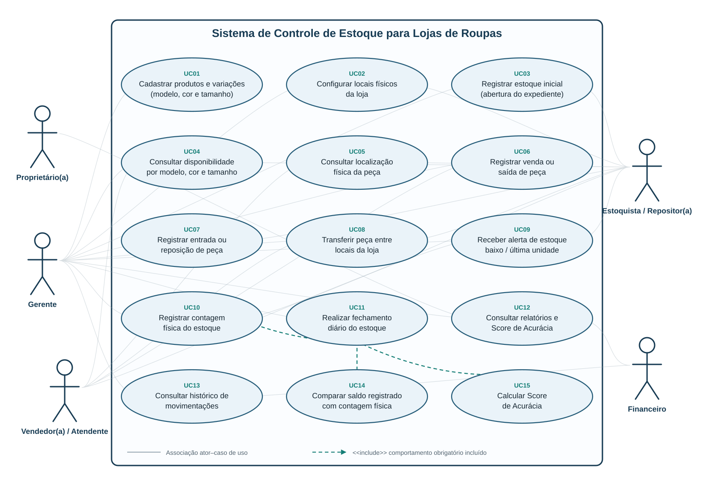

# Diagrama de Casos de Uso — Sistema de Controle de Estoque para Lojas de Roupas

## 1. Objetivo e escopo

O sistema, disponibilizado em versão web e aplicativo mobile, apoia o controle diário de roupas por modelo, cor, tamanho, quantidade e localização física. O diagrama cobre a abertura do estoque, a consulta durante o atendimento, o registro das movimentações, os alertas de estoque crítico e o fechamento diário com análise de acurácia.

Os dois canais (web e mobile) são formas de acesso ao mesmo sistema; por isso, não foram desenhados como atores separados.

## 2. Atores do sistema

| Ator | Responsabilidade / objetivo no sistema |
|---|---|
| Proprietário(a) | Acompanhar relatórios e o Score de Acurácia da loja. |
| Gerente | Coordenar o controle do estoque, cadastrar produtos e locais, acompanhar a operação, realizar/acompanhar o fechamento e consultar relatórios e histórico. |
| Vendedor(a) / Atendente | Consultar disponibilidade e localização das peças, registrar vendas/saídas e acompanhar alertas de estoque crítico. |
| Estoquista / Repositor(a) | Registrar o estoque inicial, entradas/reposições, transferências, localizações e contagens físicas. |
| Financeiro | Consultar relatórios e histórico para apoiar conferências e identificação de divergências. |

### Stakeholders que não aparecem como atores diretos

A cliente da loja é beneficiária indireta: recebe atendimento mais rápido, mas a descrição atual não prevê que ela utilize o software. O fornecedor também é beneficiário indireto, pois não há portal ou integração direta prevista para ele. O responsável pela TI é stakeholder de apoio à consistência entre web e mobile, mas a proposta não define funcionalidades administrativas específicas para sua interação direta. Esses papéis podem tornar-se atores em versões futuras, caso sejam adicionadas funcionalidades próprias.

## 3. Diagrama

O arquivo-fonte editável em PlantUML está em [Diagrama_Casos_de_Uso_Controle_Estoque.puml](Diagrama_Casos_de_Uso_Controle_Estoque.puml). A imagem SVG abaixo é uma representação do mesmo diagrama.

## 4. Catálogo de casos de uso

| ID | Caso de uso | Ator(es) principal(is) | Resultado esperado |
|---|---|---|---|
| UC01 | Cadastrar produtos e variações (modelo, cor e tamanho) | Gerente | Produtos e suas variações ficam disponíveis para registro e consulta. |
| UC02 | Configurar locais físicos da loja | Gerente, Estoquista | A loja mantém os locais onde as peças podem ser armazenadas ou expostas (araras, vitrines, prateleiras, bolsas e depósito). |
| UC03 | Registrar estoque inicial (abertura do expediente) | Gerente, Estoquista | O saldo inicial fica registrado por produto, cor, tamanho, quantidade e local. |
| UC04 | Consultar disponibilidade por modelo, cor e tamanho | Vendedor, Gerente, Estoquista | O usuário visualiza quantidades disponíveis por variação. |
| UC05 | Consultar localização física da peça | Vendedor, Estoquista | O usuário identifica o local registrado para encontrar a peça. |
| UC06 | Registrar venda ou saída de peça | Vendedor, Gerente | A saída é registrada e o saldo do local/estoque é atualizado. |
| UC07 | Registrar entrada ou reposição de peça | Estoquista | A entrada aumenta o saldo e registra o local de destino. |
| UC08 | Transferir peça entre locais da loja | Vendedor, Estoquista, Gerente | A quantidade é transferida da origem para o destino e a localização é atualizada. |
| UC09 | Receber alerta de estoque baixo / última unidade | Vendedor, Estoquista, Gerente | Os usuários são avisados quando uma variação atinge condição crítica. |
| UC10 | Registrar contagem física do estoque | Estoquista, Gerente | A quantidade efetivamente contada fica registrada para conferência. |
| UC11 | Realizar fechamento diário do estoque | Gerente | O saldo registrado é comparado à contagem física e o resultado do dia é consolidado. |
| UC12 | Consultar relatórios e Score de Acurácia | Proprietário, Gerente, Financeiro | Os responsáveis acompanham indicadores e resultados do inventário. |
| UC13 | Consultar histórico de movimentações | Gerente, Financeiro | O usuário rastreia operações registradas no sistema. |
| UC14 | Comparar saldo registrado com contagem física | Incluído por UC11 | O sistema identifica divergências entre registro e contagem. |
| UC15 | Calcular Score de Acurácia | Incluído por UC11 | O sistema apresenta a acurácia do inventário conforme fórmula a ser definida e validada. |

## 5. Descrição completa de um caso de uso (um aluno)

A descrição abaixo é um caso de uso principal, escolhido por ser central para a confiabilidade do estoque. Cada integrante do grupo deve ficar responsável por apenas um caso de uso completo; os demais casos do catálogo podem ser distribuídos entre os outros integrantes, sem duplicar a descrição.

### UC06 — Registrar venda ou saída de peça

| Campo | Descrição |
|---|---|
| **Objetivo** | Registrar a retirada de uma ou mais unidades do estoque em decorrência de uma venda ou outra saída autorizada, mantendo o saldo atualizado. |
| **Ator principal** | Vendedor(a) / Atendente. O gerente também pode executar ou acompanhar a operação, conforme as permissões que a loja definir. |
| **Atores secundários** | Não há ator secundário externo definido. A cliente é beneficiária indireta do registro correto da saída, mas não interage com o sistema neste caso de uso. |
| **Gatilho** | A cliente compra uma peça ou uma unidade precisa ser retirada do estoque. |
| **Pré-condições** | 1. O usuário está autorizado a registrar movimentações. 2. O produto e sua variação (modelo, cor e tamanho) estão cadastrados. 3. A quantidade disponível e o local de origem estão registrados no sistema. |
| **Pós-condições de sucesso** | 1. A saída fica registrada no histórico. 2. O saldo do local de origem é reduzido. 3. A quantidade total disponível é atualizada. 4. A condição de estoque baixo/última unidade é verificada. |
| **Pós-condições em caso de falha** | Nenhuma alteração parcial é confirmada; o saldo permanece como estava e o usuário recebe uma mensagem explicando o problema. |

#### Fluxo principal

1. O vendedor abre a função **Registrar venda/saída**.
2. O sistema solicita a identificação do produto.
3. O vendedor pesquisa e seleciona o modelo desejado.
4. O sistema apresenta as variações disponíveis por cor e tamanho, com suas quantidades e localizações.
5. O vendedor seleciona a cor, o tamanho e o local de onde a peça será retirada.
6. O vendedor informa a quantidade da saída.
7. O sistema valida se a quantidade informada é positiva e se existe saldo suficiente no local selecionado.
8. O sistema apresenta um resumo com produto, variação, quantidade e local de origem para conferência.
9. O vendedor confirma a operação.
10. O sistema registra a movimentação com tipo, produto, cor, tamanho, quantidade, local de origem, data/hora e usuário responsável.
11. O sistema atualiza o saldo do local e o saldo disponível da variação.
12. O sistema verifica se a quantidade restante atingiu a condição de estoque baixo ou última unidade.
13. O sistema confirma que a saída foi registrada e apresenta o saldo atualizado. Caso seja aplicável, apresenta também o alerta de estoque crítico.

#### Fluxos alternativos e exceções

- **A1 — Produto ou variação não encontrada:** o sistema informa que não localizou o cadastro. O vendedor pode refazer a pesquisa ou solicitar ao gerente que cadastre/corrija o produto. A saída não é registrada.
- **A2 — Quantidade inválida:** se o usuário informar zero, valor negativo, campo vazio ou quantidade não inteira, o sistema solicita a correção. O fluxo retorna ao passo 6.
- **A3 — Saldo insuficiente:** se a quantidade solicitada for maior que o saldo disponível no local, o sistema informa a quantidade existente e não permite confirmar a saída. O usuário pode corrigir a quantidade ou localizar outra unidade em outro local.
- **A4 — Local de origem não selecionado:** o sistema solicita que o usuário identifique de onde a peça será retirada antes de continuar.
- **A5 — Operação cancelada:** se o usuário cancelar antes da confirmação, o sistema descarta os dados ainda não confirmados e não altera o saldo.
- **A6 — Falha ao salvar a movimentação:** o sistema informa que não conseguiu concluir o registro. A saída não deve ser apresentada como concluída nem alterar o saldo; o usuário poderá tentar novamente após a normalização do serviço.

#### Regras de negócio

1. Uma movimentação de saída deve estar associada a um produto e a uma variação específica (cor e tamanho).
2. A quantidade da saída deve ser maior que zero e não pode superar o saldo disponível no local de origem.
3. Toda saída deve registrar data/hora e usuário responsável para permitir rastreabilidade.
4. A saída reduz o saldo do local de origem e o saldo total disponível da variação.
5. Quando restar uma unidade ou o limite de estoque baixo for alcançado, o sistema deve sinalizar a condição aos usuários definidos pela loja. O critério exato de estoque baixo deverá ser validado.
6. O registro da venda no sistema de estoque é considerado manual nesta proposta; integração automática com frente de caixa/PDV não foi especificada.

#### Dados envolvidos

- Identificação do produto/modelo;
- Cor;
- Tamanho;
- Quantidade retirada;
- Local de origem;
- Tipo de movimentação (venda/saída);
- Data e hora;
- Usuário responsável;
- Saldo antes e depois da operação.

#### Frequência e prioridade

- **Frequência:** alta, pois ocorre ao longo do expediente sempre que uma peça é vendida ou retirada.
- **Importância:** essencial (*Must Have* na priorização inicial), pois sem atualizar as saídas a consulta de disponibilidade perde confiabilidade.

## 6. Outros casos de uso grandes que podem ser distribuídos entre os demais alunos

Para cumprir a regra de um caso completo por aluno, os seguintes casos são boas opções para os outros integrantes:

- **UC03 — Registrar estoque inicial (abertura do expediente).**
- **UC04 — Consultar disponibilidade e localização de uma peça.** (Pode detalhar UC04 e UC05 juntos somente se o professor aceitar como um único objetivo de consulta.)
- **UC08 — Transferir peça entre locais da loja.**
- **UC11 — Realizar fechamento diário do estoque e calcular Score de Acurácia.**

Cada integrante deve escolher um caso diferente e desenvolver a sua própria especificação completa.

## 7. Premissas e pontos a validar

- Quais perfis podem registrar vendas, saídas, ajustes, transferências e contagens.
- Se as vendas serão registradas manualmente ou integradas a um PDV.
- Quais regras definem “estoque baixo” além do caso de última unidade.
- A fórmula matemática do Score de Acurácia.
- Se a atualização será exclusivamente online e como tratar indisponibilidade de conexão.
- Se haverá cadastro de novos produtos e locais exclusivamente por gerente ou também pelo proprietário.

> **Importante:** a descrição do projeto informa as funcionalidades gerais, mas não define permissões detalhadas, integração com caixa, limite configurável de alerta ou fórmula do Score. Esses pontos estão identificados como premissas a validar, não como requisitos já confirmados.
