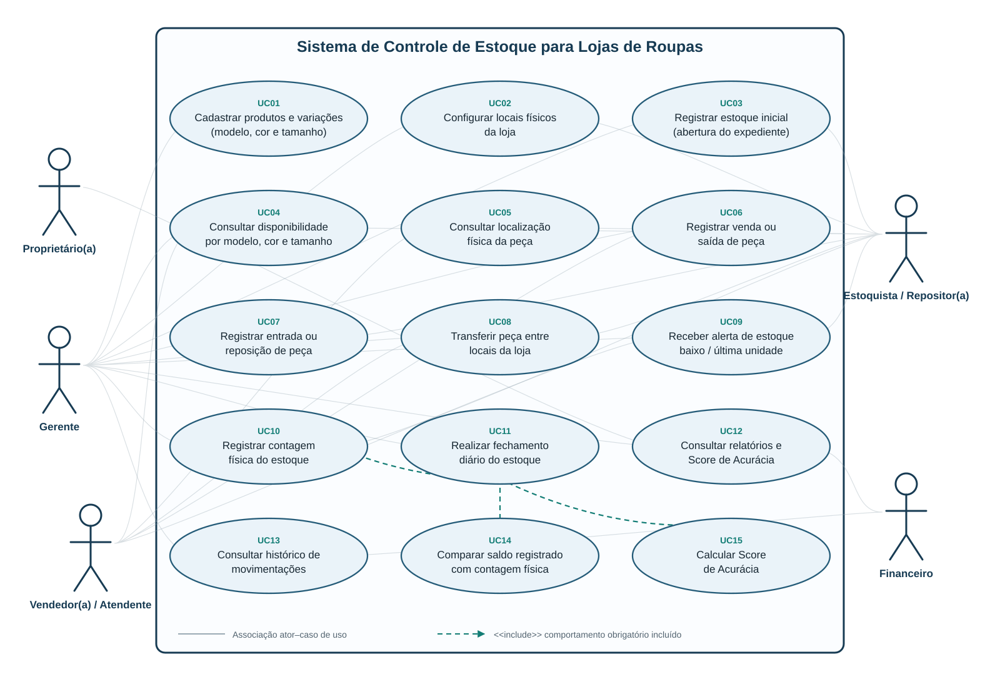
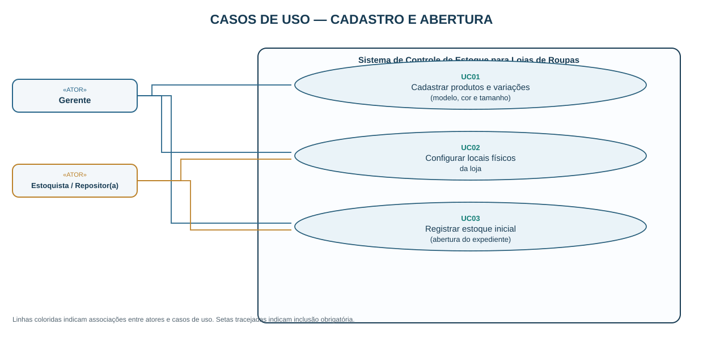
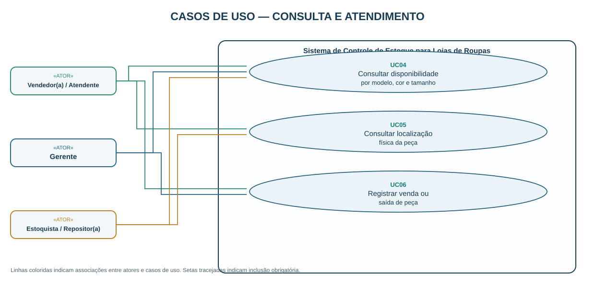
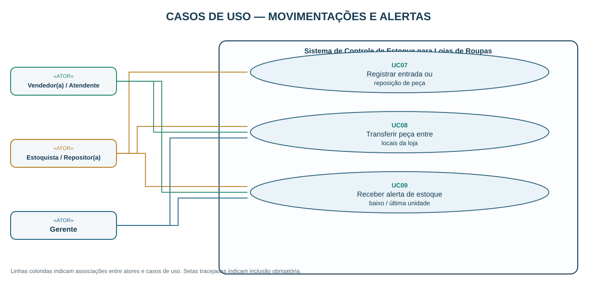
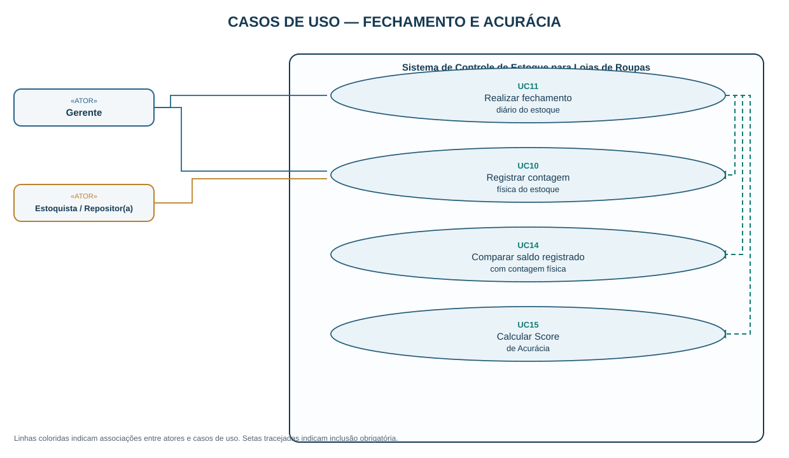
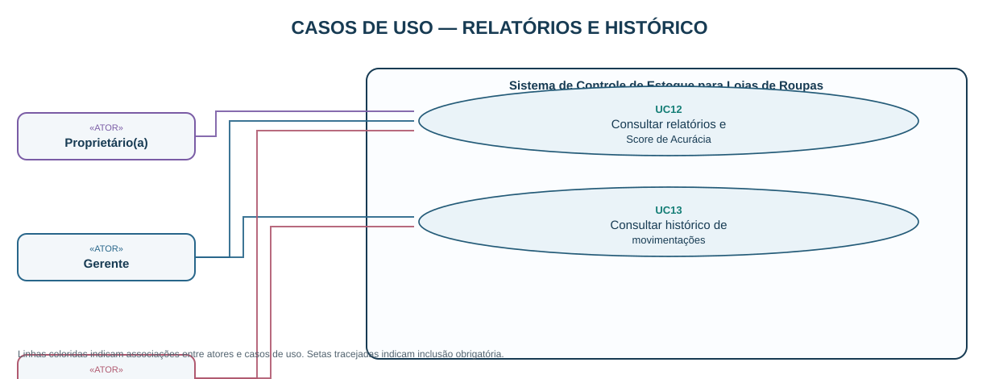

# Diagramas de Casos de Uso — versão organizada

O diagrama completo está dividido em cinco visões funcionais para reduzir cruzamentos e facilitar a leitura. Em conjunto, elas cobrem os 15 casos de uso.

## Visão geral

## Diagramas funcionais

### 1. Cadastro e abertura — UC01 a UC03

[Visualizar em SVG](01_Cadastro_e_Abertura.svg)

### 2. Consulta e atendimento — UC04 a UC06

[Visualizar em SVG](02_Consulta_e_Atendimento.svg)

### 3. Movimentações e alertas — UC07 a UC09

[Visualizar em SVG](03_Movimentacoes_e_Alertas.svg)

### 4. Fechamento e acurácia — UC10, UC11, UC14 e UC15

[Visualizar em SVG](04_Fechamento_e_Acuracia.svg)

### 5. Relatórios e histórico — UC12 e UC13

[Visualizar em SVG](05_Relatorios_e_Historico.svg)

## Atores diretos

- Proprietário(a)
- Gerente
- Vendedor(a) / Atendente
- Estoquista / Repositor(a)
- Financeiro

Cliente e fornecedor continuam como beneficiários indiretos, sem acesso próprio previsto no escopo atual. O responsável pela TI é stakeholder de apoio, sem caso de uso administrativo definido.

## Documentação complementar

- [Catálogo e descrição completa do UC06](../Descricao_Casos_de_Uso_Controle_Estoque.md)
- [Cenários principais e alternativos dos 15 casos de uso](../Cenarios_Principais_e_Alternativos.md)
- [Fonte PlantUML das cinco visões](../Diagrama_Casos_de_Uso_Controle_Estoque.puml)
