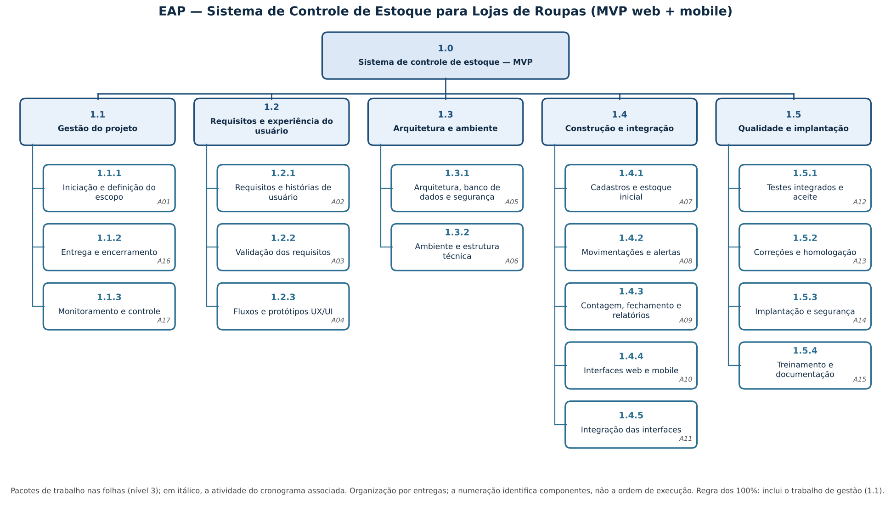
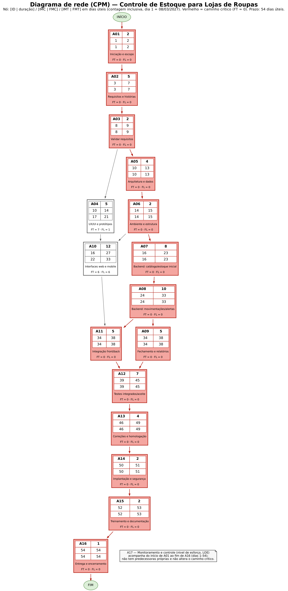

# Gestão de Projeto — Sistema de Controle de Estoque para Lojas de Roupas

> Entrega da tarefa **Gestão de Projeto** (EEL873 — Engenharia de Software). A fonte editável de todo o conteúdo é a planilha [`Planejamento_Projeto_Controle_Estoque_Roupas.xlsx`](Planejamento_Projeto_Controle_Estoque_Roupas.xlsx).

## Resumo

| BAC | Duração | Início | Término |
|---|---|---|---|
| **R$ 55.143,00** | 54 dias úteis | 08/03/2027 | 24/05/2027 |

Desenvolver um MVP web responsivo, com uso no celular via PWA, para dar visibilidade ao estoque de roupas por modelo, cor, tamanho, quantidade e localização física. O sistema apoiará a abertura do estoque, consultas durante o atendimento, registro de vendas/saídas, entradas/reposições, transferências, alertas de última unidade/estoque baixo, contagem física e fechamento diário com análise de acurácia.

**Sumário:** [1. Escopo](#1-declaração-do-escopo) · [2. EAP](#2-estrutura-analítica-do-projeto-eap) · [3. Rede](#3-diagrama-de-rede-e-tabela-cpm) · [4. Baseline](#4-cronograma-baseline) · [5. Recursos](#5-recursos-por-atividade) · [6. Custos e BAC](#6-custos-e-bac)

## 1. Declaração do escopo

| Campo | Definição |
|---|---|
| **Nome do projeto** | Sistema de Controle de Estoque para Lojas de Roupas (aplicação web responsiva, instalável no celular como PWA). |
| **Objetivo** | Desenvolver uma solução para registrar, consultar e movimentar o estoque de roupas por modelo, cor, tamanho, quantidade e localização física, reduzindo o tempo de busca e melhorando a confiabilidade dos saldos. |
| **Descrição do produto** | Aplicação web responsiva, acessível no computador e instalável no celular como PWA (Progressive Web App), com uma única base de dados, permitindo abertura do estoque, consulta de disponibilidade/localização, registro de entradas e saídas, transferências, alertas de estoque crítico, contagem física, fechamento diário e relatórios/Score de Acurácia. |
| **Escopo incluído** | 1) Cadastro de produtos e variações (modelo, cor e tamanho). 2) Cadastro de locais físicos: araras, vitrines, prateleiras, bolsas e depósito. 3) Registro do estoque inicial por variação e local. 4) Consulta de quantidades por produto, cor e tamanho. 5) Consulta de localização física. 6) Registro de vendas/saídas, entradas/reposições e transferências. 7) Atualização do saldo após movimentações confirmadas. 8) Alertas de última unidade e estoque baixo conforme limite aprovado. 9) Registro de contagem física. 10) Fechamento diário, identificação de divergências e Score após aprovação da fórmula. 11) Histórico de movimentações e relatórios básicos. |
| **Entregáveis** | Termo de abertura e escopo; requisitos e histórias de usuário; protótipos UX/UI; arquitetura e modelo de dados; ambiente técnico; backend; interfaces web/mobile; integração; testes e homologação; implantação; documentação e treinamento; relatórios de acompanhamento (status) do projeto; aceite e encerramento. |
| **Critérios de aceitação** | 1) Cadastrar produto/variação e local. 2) Registrar abertura por produto, cor, tamanho e local. 3) Consultar saldo e localização corretamente. 4) Registrar saída, reduzir saldo e impedir baixa acima do disponível. 5) Registrar entrada e transferência, atualizando origem/destino. 6) Sinalizar última unidade e limites aprovados. 7) Registrar contagem e comparar com saldo esperado. 8) Consolidar fechamento e divergências. 9) Calcular Score somente após aprovação formal da fórmula. 10) Aprovar testes dos fluxos prioritários com representante da loja. |
| **Exclusões** | Integração automática com ERP/PDV/caixa; portal de fornecedores; aplicativo/portal de consumidores; e-commerce; leitores RFID/hardware dedicado; previsão de demanda com IA; gestão multiunidade; modo offline; contabilidade/faturamento completo; aplicativo nativo e publicação em lojas de aplicativos (App Store/Google Play). |
| **Premissas** | 1) A loja piloto indicará um usuário-chave (gerente ou proprietário) com cerca de 20 h disponíveis em A02, A03 e A12, como contrapartida do cliente. 2) A loja fornecerá exemplos reais de produtos, cores, tamanhos e locais físicos até o início de A02. 3) Vendas e saídas serão registradas manualmente no sistema, sem integração com caixa/PDV. 4) A loja terá internet estável durante o expediente (o sistema opera somente online). 5) A equipe será de prestadores PJ, um profissional por papel, com alocação parcial e no máximo 8 h por dia útil. 6) Ambientes de nuvem, repositório e ferramentas estarão contratados e acessíveis no início do projeto. |
| **Restrições** | 1) Prazo: 54 dias úteis, de 08/03/2027 a 24/05/2027. 2) Orçamento limitado ao BAC aprovado; mudanças de escopo exigem análise de impacto em prazo e custo antes da aprovação. 3) Uma única loja piloto; o acesso mobile será via PWA, usando a mesma base de dados e a mesma API da versão web. 4) Operação somente online (modo offline excluído). |
| **Decisões pendentes** | 1) Fórmula do Score de Acurácia — responsável: proprietário da loja; decidir até o M1 (18/03/2027). Sem aprovação, o Score sai do MVP e o fechamento entrega apenas as divergências. 2) Regra de estoque baixo além da última unidade (limite por produto ou global) — decidir em A03. 3) Perfis e permissões (quem registra vendas, ajustes, transferências e contagens) — definir em A02. |
| **Stakeholders-chave** | Proprietário (patrocínio/aceite); gerente (operação e fechamento); vendedor (consulta e saídas); estoquista (abertura, entradas, transferências e contagem); financeiro (relatórios e histórico); equipe técnica (construção e operação). |
| **Critérios de sucesso** | Localização e resposta sobre disponibilidade mais rápidas; movimentações rastreáveis; nenhuma operação gera saldo negativo; fechamento evidencia divergências; usuários-chave aprovam o MVP. |
| **Limites da estimativa** | Estimativa de MVP acadêmico/piloto. Não inclui expansão multiunidade nem integração legada. Os valores devem ser recalibrados com custos reais, impostos/encargos e cotações. |

## 2. Estrutura Analítica do Projeto (EAP)

| Código | Elemento / pacote | Descrição | Critério de aceite | Atividades |
|---|---|---|---|---|
| 1.0 | **Sistema de controle de estoque — MVP** | Projeto completo | Sistema web/mobile aceito e implantado na loja piloto | A01–A17 |
| 1.1 | **Gestão do projeto** | Coordenação, controle e encerramento | Escopo aprovado, decisões registradas e entrega formal | A01, A16, A17 |
| 1.1.1 | Iniciação e definição do escopo | Kickoff, objetivos, premissas e limites | Declaração de escopo validada | A01 |
| 1.1.2 | Entrega e encerramento | Aceite final, handover e encerramento | Termo de entrega e pendências documentadas | A16 |
| 1.1.3 | Monitoramento e controle | Acompanhamento semanal de prazo, custo (EVM), riscos e mudanças ao longo de todo o projeto | Relatórios semanais de status, registro de riscos/decisões e mudanças analisadas | A17 |
| 1.2 | **Requisitos e experiência do usuário** | Descoberta, validação e UX/UI | Requisitos e protótipos aprovados | A02–A04 |
| 1.2.1 | Requisitos e histórias de usuário | Requisitos funcionais e não funcionais | Histórias priorizadas e critérios de aceite | A02 |
| 1.2.2 | Validação dos requisitos | Revisão com usuários-chave | Requisitos e critérios de aceite validados | A03 |
| 1.2.3 | Fluxos e protótipos UX/UI | Jornadas e telas web/mobile | Protótipos revisados | A04 |
| 1.3 | **Arquitetura e ambiente** | Decisões técnicas e preparação | Arquitetura e ambiente prontos | A05–A06 |
| 1.3.1 | Arquitetura, banco de dados e segurança | Modelo de dados, API e controles básicos | Arquitetura e modelo de dados documentados | A05 |
| 1.3.2 | Ambiente e estrutura técnica | Repositório, ambientes, base e pipeline | Ambiente técnico disponível e validado | A06 |
| 1.4 | **Construção e integração** | Backend, interfaces e integração | Funcionalidades prioritárias implementadas | A07–A11 |
| 1.4.1 | Cadastros e estoque inicial | Produtos, variações, locais e abertura | Cadastros e estoque inicial testáveis | A07 |
| 1.4.2 | Movimentações e alertas | Saídas, entradas, transferências e alertas | Saldos consistentes e movimentações rastreáveis | A08 |
| 1.4.3 | Contagem, fechamento e relatórios | Conferência física e fechamento diário | Relatórios e divergências; Score condicionado à fórmula aprovada | A09 |
| 1.4.4 | Interfaces web e mobile | Telas de consulta, cadastro e movimentação | Interfaces conectadas à API | A10 |
| 1.4.5 | Integração das interfaces | Integração web/mobile com backend | Fluxos ponta a ponta funcionais | A11 |
| 1.5 | **Qualidade e implantação** | Testes, correções, implantação e treinamento | MVP testado e disponibilizado à loja piloto | A12–A15 |
| 1.5.1 | Testes integrados e aceite | Testes funcionais e validação do usuário | Evidências e aceite dos fluxos prioritários | A12 |
| 1.5.2 | Correções e homologação | Tratamento de defeitos e reteste | Defeitos críticos corrigidos | A13 |
| 1.5.3 | Implantação e segurança | Deploy, backup e verificações | Versão implantada e backup verificado | A14 |
| 1.5.4 | Treinamento e documentação | Guia rápido e treinamento | Usuários-chave treinados e guia entregue | A15 |

## 3. Diagrama de rede e tabela CPM

IMC/FMC = início/fim mais cedo (ES/EF); IMT/FMT = início/fim mais tarde (LS/LF). Contagem inclusiva: dia útil 1 = início da baseline. FT = IMT − IMC; FL = menor IMC das sucessoras − FMC − 1.

| ID | Atividade | Duração (d.u.) | Predecessoras | IMC | FMC | IMT | FMT | FT | FL | Crítica? |
|---|---|---|---|---|---|---|---|---|---|---|
| A01 | Iniciação e definição do escopo | 2 | — | 1 | 2 | 1 | 2 | 0 | 0 | SIM |
| A02 | Levantamento de requisitos e histórias de usuário | 5 | A01 | 3 | 7 | 3 | 7 | 0 | 0 | SIM |
| A03 | Validação dos requisitos e critérios de aceite | 2 | A02 | 8 | 9 | 8 | 9 | 0 | 0 | SIM |
| A04 | Fluxos e protótipos UX/UI | 5 | A03 | 10 | 14 | 17 | 21 | 7 | 1 | NÃO |
| A05 | Arquitetura, banco de dados e segurança | 4 | A03 | 10 | 13 | 10 | 13 | 0 | 0 | SIM |
| A06 | Preparação do ambiente e estrutura técnica | 2 | A05 | 14 | 15 | 14 | 15 | 0 | 0 | SIM |
| A07 | Backend: cadastros e estoque inicial | 8 | A06 | 16 | 23 | 16 | 23 | 0 | 0 | SIM |
| A08 | Backend: saídas, entradas, transferências e alertas | 10 | A07 | 24 | 33 | 24 | 33 | 0 | 0 | SIM |
| A09 | Backend: contagem, fechamento e relatórios | 5 | A08 | 34 | 38 | 34 | 38 | 0 | 0 | SIM |
| A10 | Desenvolvimento das interfaces web e mobile | 12 | A04, A06 | 16 | 27 | 22 | 33 | 6 | 6 | NÃO |
| A11 | Integração das interfaces com os serviços | 5 | A08, A10 | 34 | 38 | 34 | 38 | 0 | 0 | SIM |
| A12 | Testes integrados e validação com usuários | 7 | A09, A11 | 39 | 45 | 39 | 45 | 0 | 0 | SIM |
| A13 | Correções, retestes e homologação | 4 | A12 | 46 | 49 | 46 | 49 | 0 | 0 | SIM |
| A14 | Implantação, backup e verificação de segurança | 2 | A13 | 50 | 51 | 50 | 51 | 0 | 0 | SIM |
| A15 | Treinamento e documentação de operação | 2 | A14 | 52 | 53 | 52 | 53 | 0 | 0 | SIM |
| A16 | Entrega e encerramento do projeto | 1 | A15 | 54 | 54 | 54 | 54 | 0 | 0 | SIM |
| A17 | Monitoramento e controle do projeto (esforço contínuo) | 54 | Acompanha A01–A16 | 1 | 54 | — | — | — | — | N/A |

Duração total: 54 dias úteis. Caminho crítico (FT = 0): A01 → A02 → A03 → A05 → A06 → A07 → A08 → (A09 e A11) → A12 → A13 → A14 → A15 → A16; há dois ramos críticos em paralelo entre A08 e A12. A04 tem FT de 7 d.u., mas FL de só 1 d.u.: atrasar A04 mais de 1 dia consome a folga de A10, porque as folgas do caminho A04 → A10 → A11 são compartilhadas. A10 tem FT = FL = 6 d.u. Relações término–início; datas em dias úteis, considerando os feriados das premissas. A17 (monitoramento e controle) é nível de esforço: acompanha do início de A01 ao fim de A16 e não altera o caminho crítico.

## 4. Cronograma baseline

| ID | Atividade | Início | Fim | Duração | Responsáveis |
|---|---|---|---|---|---|
| A01 | Iniciação e definição do escopo | 08/03/2027 | 09/03/2027 | 2 | Gerente de projeto / Analista de requisitos |
| A02 | Levantamento de requisitos e histórias de usuário | 10/03/2027 | 16/03/2027 | 5 | Analista de requisitos / Gerente de projeto / Representante da loja |
| A03 | Validação dos requisitos e critérios de aceite | 17/03/2027 | 18/03/2027 | 2 | Analista de requisitos / Representante da loja / Gerente de projeto |
| A04 | Fluxos e protótipos UX/UI | 19/03/2027 | 25/03/2027 | 5 | Designer UX/UI / Analista de requisitos |
| A05 | Arquitetura, banco de dados e segurança | 19/03/2027 | 24/03/2027 | 4 | Desenvolvedor backend / DevOps |
| A06 | Preparação do ambiente e estrutura técnica | 25/03/2027 | 29/03/2027 | 2 | DevOps / Desenvolvedor backend |
| A07 | Backend: cadastros e estoque inicial | 30/03/2027 | 08/04/2027 | 8 | Desenvolvedor backend / Web-mobile / QA |
| A08 | Backend: saídas, entradas, transferências e alertas | 09/04/2027 | 23/04/2027 | 10 | Desenvolvedor backend / Web-mobile / QA |
| A09 | Backend: contagem, fechamento e relatórios | 26/04/2027 | 30/04/2027 | 5 | Desenvolvedor backend / Web-mobile / QA |
| A10 | Desenvolvimento das interfaces web e mobile | 30/03/2027 | 14/04/2027 | 12 | Desenvolvedor web/mobile / Designer UX/UI / QA |
| A11 | Integração das interfaces com os serviços | 26/04/2027 | 30/04/2027 | 5 | Backend / Web-mobile / QA |
| A12 | Testes integrados e validação com usuários | 03/05/2027 | 11/05/2027 | 7 | QA / Backend / Web-mobile / Representante da loja |
| A13 | Correções, retestes e homologação | 12/05/2027 | 17/05/2027 | 4 | QA / Backend / Web-mobile |
| A14 | Implantação, backup e verificação de segurança | 18/05/2027 | 19/05/2027 | 2 | DevOps / Backend |
| A15 | Treinamento e documentação de operação | 20/05/2027 | 21/05/2027 | 2 | Analista de requisitos / Treinamento e documentação / Gerente de projeto |
| A16 | Entrega e encerramento do projeto | 24/05/2027 | 24/05/2027 | 1 | Gerente de projeto / Analista de requisitos |
| A17 | Monitoramento e controle do projeto (esforço contínuo) | 08/03/2027 | 24/05/2027 | 54 | Gerente de projeto |

**Marcos**

| Marco | Descrição | Data | Referência |
|---|---|---|---|
| Marco | Descrição | Data planejada | Referência |
| M1 | Requisitos e critérios validados | 18/03/2027 | Conclusão A03 |
| M2 | Protótipo e ambiente técnico prontos | 29/03/2027 | Conclusão A04/A06 |
| M3 | Movimentações e alertas implementados | 23/04/2027 | Conclusão A08 |
| M4 | Backend e integração prontos | 30/04/2027 | Conclusão A09/A11 |
| M5 | Homologação concluída | 17/05/2027 | Conclusão A13 |
| M6 | Entrega final | 24/05/2027 | Conclusão A16 |

O Gantt semanal (S1–S12) está na aba **Baseline** da planilha.

## 5. Recursos por atividade

Alocação estimada em horas por pacote de trabalho. Custo = horas × valor-hora PJ (prestadores contratados por projeto). As taxas ficam na tabela ao lado (coluna I) e alimentam a coluna E.

| Atividade | Recurso | Horas | Taxa PJ (R$/h) | Custo |
|---|---|---|---|---|
| A01 | Gerente de projeto | 8 | 75 | R$ 600,00 |
| A01 | Analista de requisitos | 4 | 65 | R$ 260,00 |
| A02 | Analista de requisitos | 24 | 65 | R$ 1.560,00 |
| A02 | Gerente de projeto | 4 | 75 | R$ 300,00 |
| A02 | Representante da loja | 8 | 0 | R$ 0,00 |
| A03 | Analista de requisitos | 8 | 65 | R$ 520,00 |
| A03 | Representante da loja | 4 | 0 | R$ 0,00 |
| A03 | Gerente de projeto | 2 | 75 | R$ 150,00 |
| A04 | Designer UX/UI | 32 | 60 | R$ 1.920,00 |
| A04 | Analista de requisitos | 4 | 65 | R$ 260,00 |
| A05 | Desenvolvedor backend | 20 | 85 | R$ 1.700,00 |
| A05 | DevOps e segurança | 8 | 90 | R$ 720,00 |
| A06 | DevOps e segurança | 12 | 90 | R$ 1.080,00 |
| A06 | Desenvolvedor backend | 4 | 85 | R$ 340,00 |
| A07 | Desenvolvedor backend | 48 | 85 | R$ 4.080,00 |
| A07 | Desenvolvedor web/mobile | 8 | 80 | R$ 640,00 |
| A07 | QA e testes | 8 | 55 | R$ 440,00 |
| A08 | Desenvolvedor backend | 56 | 85 | R$ 4.760,00 |
| A08 | Desenvolvedor web/mobile | 16 | 80 | R$ 1.280,00 |
| A08 | QA e testes | 12 | 55 | R$ 660,00 |
| A09 | Desenvolvedor backend | 24 | 85 | R$ 2.040,00 |
| A09 | Desenvolvedor web/mobile | 8 | 80 | R$ 640,00 |
| A09 | QA e testes | 12 | 55 | R$ 660,00 |
| A10 | Desenvolvedor web/mobile | 72 | 80 | R$ 5.760,00 |
| A10 | Designer UX/UI | 8 | 60 | R$ 480,00 |
| A10 | QA e testes | 8 | 55 | R$ 440,00 |
| A11 | Desenvolvedor backend | 14 | 85 | R$ 1.190,00 |
| A11 | Desenvolvedor web/mobile | 30 | 80 | R$ 2.400,00 |
| A11 | QA e testes | 16 | 55 | R$ 880,00 |
| A12 | QA e testes | 40 | 55 | R$ 2.200,00 |
| A12 | Desenvolvedor backend | 8 | 85 | R$ 680,00 |
| A12 | Desenvolvedor web/mobile | 8 | 80 | R$ 640,00 |
| A12 | Representante da loja | 8 | 0 | R$ 0,00 |
| A13 | QA e testes | 12 | 55 | R$ 660,00 |
| A13 | Desenvolvedor backend | 12 | 85 | R$ 1.020,00 |
| A13 | Desenvolvedor web/mobile | 8 | 80 | R$ 640,00 |
| A14 | DevOps e segurança | 16 | 90 | R$ 1.440,00 |
| A14 | Desenvolvedor backend | 4 | 85 | R$ 340,00 |
| A15 | Analista de requisitos | 6 | 65 | R$ 390,00 |
| A15 | Treinamento e documentação | 8 | 50 | R$ 400,00 |
| A15 | Gerente de projeto | 2 | 75 | R$ 150,00 |
| A16 | Gerente de projeto | 4 | 75 | R$ 300,00 |
| A16 | Analista de requisitos | 2 | 65 | R$ 130,00 |
| A17 | Gerente de projeto | 44 | 75 | R$ 3.300,00 |

**Totais por recurso**

| Recurso | Taxa PJ (R$/h) | Horas | Custo |
|---|---|---|---|
| Gerente de projeto | 75 | 64 | R$ 4.800,00 |
| Analista de requisitos | 65 | 48 | R$ 3.120,00 |
| Designer UX/UI | 60 | 40 | R$ 2.400,00 |
| Desenvolvedor backend | 85 | 190 | R$ 16.150,00 |
| Desenvolvedor web/mobile | 80 | 150 | R$ 12.000,00 |
| QA e testes | 55 | 108 | R$ 5.940,00 |
| DevOps e segurança | 90 | 36 | R$ 3.240,00 |
| Representante da loja | 0 | 20 | R$ 0,00 |
| Treinamento e documentação | 50 | 8 | R$ 400,00 |
| TOTAL DE RECURSOS |  | 664 | R$ 48.050,00 |

> Valores-hora PJ: referência de mercado 2026 para desenvolvedores PJ no Brasil — júnior R$ 50–90/h, pleno R$ 80–160/h, sênior R$ 130–260/h (Agilize, "Salário de dev freelance", 2026: https://artigos.agilize.com.br/salario-dev-freelance-2026/). Valores adotados na faixa júnior/pleno, compatíveis com um MVP de baixa complexidade.
>
> Nivelamento: com um profissional por papel, A09 e A11 em paralelo sobrecarregavam o backend nos dias 34–38. 6 h de integração (A11) passaram para web/mobile; pico do backend: 8,8 → 7,6 h/dia. Prazo e caminho crítico inalterados.
>
> Representante da loja: as horas ficam registradas porque o projeto depende do usuário-chave (A02, A03 e A12), mas esse tempo é contrapartida do cliente e não entra no BAC.

## 6. Custos e BAC

| Componente | Valor |
|---|---|
| Mão de obra direta | R$ 48.050,00 |
| Custos não laborais | R$ 2.080,00 |
| Custo direto total | R$ 50.130,00 |
| Taxa de contingência | 10% |
| Reserva de contingência | R$ 5.013,00 |
| Reserva gerencial (fora do BAC) | R$ 0,00 |
| **BAC — orçamento na conclusão** | R$ 55.143,00 |

**Custos não laborais**

| Item | Base de estimativa | Valor |
|---|---|---|
| Infraestrutura cloud e banco de dados | 3 meses de desenvolvimento, homologação e produção inicial | R$ 900,00 |
| Domínio e configuração DNS | Registro anual estimado | R$ 80,00 |
| Ferramentas/licenças e colaboração | 3 meses de ferramentas de desenvolvimento, design e gestão | R$ 600,00 |
| Dispositivo/acessórios e conectividade para testes | Celular de teste e conectividade para validar o PWA em Android e iOS | R$ 500,00 |

**BAC por pacote da EAP**

| Pacote de trabalho | Atividade | Custo |
|---|---|---|
| 1.1.1 Iniciação e definição do escopo | A01 | R$ 860,00 |
| 1.1.2 Entrega e encerramento | A16 | R$ 430,00 |
| 1.1.3 Monitoramento e controle | A17 | R$ 3.300,00 |
| 1.2.1 Requisitos e histórias de usuário | A02 | R$ 1.860,00 |
| 1.2.2 Validação dos requisitos | A03 | R$ 670,00 |
| 1.2.3 Fluxos e protótipos UX/UI | A04 | R$ 2.180,00 |
| 1.3.1 Arquitetura, banco de dados e segurança | A05 | R$ 2.420,00 |
| 1.3.2 Ambiente e estrutura técnica | A06 | R$ 1.420,00 |
| 1.4.1 Cadastros e estoque inicial | A07 | R$ 5.160,00 |
| 1.4.2 Movimentações e alertas | A08 | R$ 6.700,00 |
| 1.4.3 Contagem, fechamento e relatórios | A09 | R$ 3.340,00 |
| 1.4.4 Interfaces web e mobile | A10 | R$ 6.680,00 |
| 1.4.5 Integração das interfaces | A11 | R$ 4.470,00 |
| 1.5.1 Testes integrados e aceite | A12 | R$ 3.520,00 |
| 1.5.2 Correções e homologação | A13 | R$ 2.320,00 |
| 1.5.3 Implantação e segurança | A14 | R$ 1.780,00 |
| 1.5.4 Treinamento e documentação | A15 | R$ 940,00 |
| Subtotal — mão de obra |  | R$ 48.050,00 |
| Custos não laborais |  | R$ 2.080,00 |
| Reserva de contingência (10%) |  | R$ 5.013,00 |
| BAC — orçamento na conclusão |  | R$ 55.143,00 |

> PREMISSAS FINANCEIRAS: as taxas são valores-hora de prestadores PJ (já incluem os tributos do prestador; não há encargos trabalhistas), na faixa júnior/pleno do mercado brasileiro em 2026. O tempo do usuário-chave da loja é contrapartida do cliente e não entra no BAC. Os custos não laborais são estimativas globais, não cotações. A reserva de contingência de 10% cobre riscos identificados (retrabalho, testes adicionais, ajustes de implantação) e integra o BAC; a reserva gerencial fica fora da linha de base de medição e, portanto, fora do BAC.

